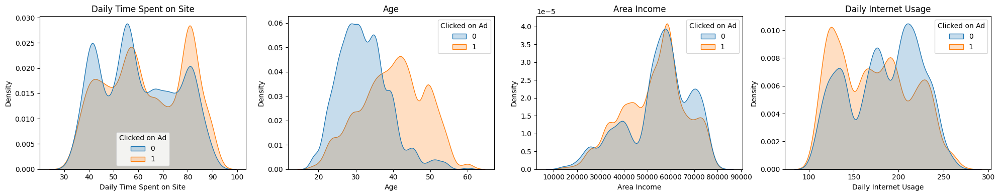
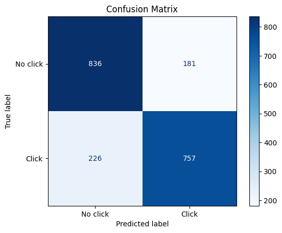
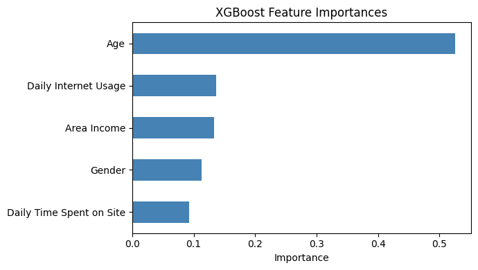

# Ad Click Prediction with XGBoost

Predicts whether a website visitor will **click on an online advertisement** from their browsing behaviour and demographics, using an XGBoost classifier. It also measures the overall **click-through rate (CTR)** of the ad campaign.

## What it does

1. Loads the advertising dataset (`ad_10000records.csv`, 10,000 visitors). Each row has:
   - daily time on the site, age, area income and daily internet usage;
   - the ad topic line, city, gender, country and a timestamp;
   - whether the visitor clicked the ad.
2. Prints how many visitors clicked and computes the **click-through rate** from the data.
3. Plots how each numeric feature is distributed for clickers vs. non-clickers.
4. Label-encodes `Gender`.
5. Selects five features by name: daily time spent on site, age, area income, daily internet usage and gender. The free-text columns (ad topic line, city, country) and the timestamp are left out.
6. Splits the data into 80% training and 20% test, **stratified** so both keep the same click ratio.
7. Trains an XGBoost classifier and reports accuracy plus precision, recall and F1 for each class.
8. Plots a confusion matrix and the model's feature importances.

## Concepts covered

- **Click-through rate** — CTR = clicks ÷ impressions × 100. It is the basic success metric for an online ad. The script computes it from the data instead of a hard-coded number, so it stays correct if the dataset changes.
- **Binary classification** — every visitor either clicks (1) or doesn't (0). The model outputs one of the two classes.
- **Selecting features by name** — choosing columns with names (`df[["Age", ...]]`) instead of positions (`df.iloc[:, 0:7]`) means the code keeps working if the column order changes. It also makes clear which inputs the model actually uses.
- **Why some columns are dropped** — `Ad Topic Line` and `City` are almost unique for every row, so a model can't learn general patterns from them as-is. `Country` and `Timestamp` would need extra feature engineering, such as hour of day or day of week.
- **Label encoding** — gender is text (`Male` / `Female`), so it is mapped to 0/1 for the model.
- **Stratified splitting** — keeps the proportion of clickers identical in the training and test sets, so the test score isn't skewed by an unlucky split.
- **XGBoost** — gradient-boosted decision trees. Each new tree corrects the mistakes of the ones before it. It handles features on very different scales (age vs. income) without any scaling and usually performs strongly on tabular data like this.
- **Feature importance** — XGBoost reports how much each feature contributed to its decisions. That turns the model from a black box into something a marketing team can learn from, for example "heavy internet users click less".

## Project structure

```
main.py      # full pipeline, organized into functions (config, loading,
              # click-through rate, encoding, stratified split, XGBoost
              # training, evaluation, feature importances, plotting)
README.md    # this file
```

The code is organized into small, named functions driven by a `PipelineConfig` dataclass: `load_data`, `click_through_rate`, `encode_categoricals`, `split_data`, `train_xgboost`, `evaluate_model`, `feature_importances`, `plot_feature_distributions`, `plot_confusion_matrix`, `plot_feature_importances`. `run_pipeline()` runs them in order.

Settings such as the feature list, test size and random seed live in `PipelineConfig`, so you can experiment without touching the pipeline code. For example, to see how well the model does without demographic features:

```python
from main import PipelineConfig, run_pipeline

run_pipeline(PipelineConfig(
    feature_columns=["Daily Time Spent on Site", "Daily Internet Usage"],
    categorical_columns=[],
))
```

## Requirements

```
pandas
matplotlib
seaborn
scikit-learn
xgboost
```

Install with:

```bash
pip install pandas matplotlib seaborn scikit-learn xgboost
```

## How to run

Place `ad_10000records.csv` in the same directory as `main.py`, then:

```bash
python main.py
```

## Sample output

Running the script prints the click counts and click-through rate, the features used, the model accuracy, a classification report and the feature importances, then displays the charts.

**Feature distributions: clickers vs. non-clickers**



**Confusion matrix**



**Feature importances**



## A note on the results

The click-through rate in this dataset is close to 50%: about 4,900 of the 10,000 visitors clicked. That is far higher than real online ads, which usually see CTRs of a few percent, so this is a balanced teaching dataset rather than real campaign data. The upside is that accuracy is a fair metric here. The baseline of always guessing one class is only about 50%, so any accuracy well above that reflects real signal.

The feature-distribution plots usually explain the result before the model does: clickers and non-clickers differ clearly in time spent on site and daily internet usage. Expect those two to rank near the top of the feature importances. Natural next steps would be:

- engineering features from `Timestamp` (hour of day, weekday) and `Country`;
- tuning XGBoost's hyperparameters with cross-validation;
- predicting click *probabilities* (`predict_proba`) instead of hard yes/no labels, so ads can be ranked by how likely each visitor is to click.

## References

- [XGBoost documentation](https://xgboost.readthedocs.io/)
- [scikit-learn — classification metrics](https://scikit-learn.org/stable/modules/model_evaluation.html#classification-metrics)
- [GeeksforGeeks — Machine Learning Projects](https://www.geeksforgeeks.org/machine-learning/machine-learning-projects/), used as a general reference/inspiration while working on this project.

---
*This is a personal learning project for practising classification.*
