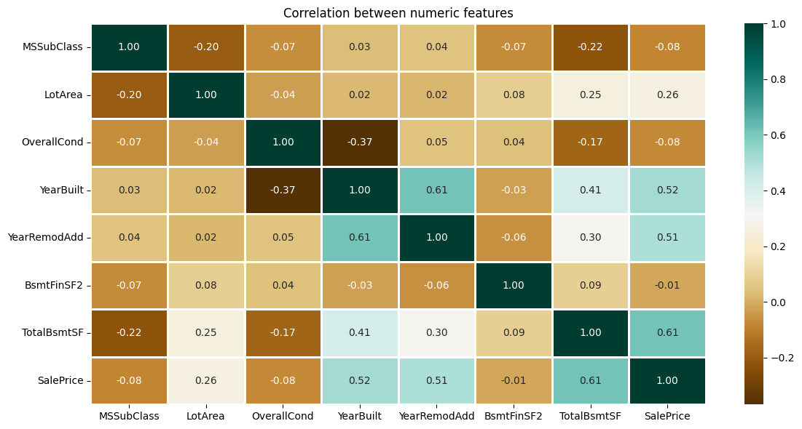
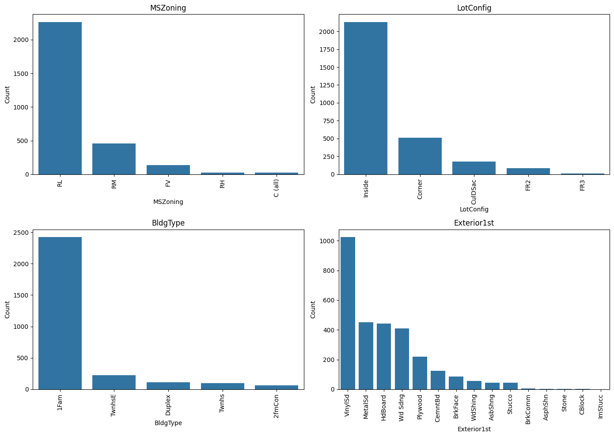

# House Price Prediction

Predicts a house's **sale price** from its lot, building and zoning details. It compares three regression models (Support Vector Regression, Random Forest and Linear Regression) using Mean Absolute Percentage Error (MAPE).

## What it does

1. Loads the housing data (`HousePricePrediction.xlsx`, 2,919 rows, 13 columns):
   - lot area and lot configuration;
   - building class and type, and zoning;
   - overall condition, year built and year remodelled;
   - exterior material and basement size;
   - sale price.
2. Counts the categorical, integer and float columns.
3. Plots a correlation heatmap of the numeric features, the number of unique values in each categorical feature, and the distribution of every category.
4. Drops the `Id` column and **removes houses with no recorded sale price**, plus the few rows with other missing values.
5. Splits the data into 80% training and 20% validation.
6. Builds a **preprocessing pipeline**, fitted on the training data only: one-hot encodes the categorical features and standardizes the numeric ones.
7. Trains Support Vector Regression (with a scaled target), Random Forest and Linear Regression. Compares their validation **MAPE** and **MAE** against a baseline that always predicts the median price.

## Concepts covered

- **Never fill in the target** — the original notebook filled missing sale prices with the average price. That invents thousands of fake houses that all cost exactly the same, and the model then learns to predict that number. Rows without a price can't teach the model anything, so they are removed.
- **One-hot encoding** — categories like zoning (`RL`, `RM`, `FV`…) have no natural order, so each one becomes its own 0/1 column. That way the model doesn't treat `FV` as "bigger" than `RL`.
- **Preprocessing pipelines** — `ColumnTransformer` and `Pipeline` apply encoding and scaling inside each model. They learn only from the training data, so no information from the validation set leaks into training.
- **Scaling the features *and* the target for SVR** — SVR measures distances between houses, so lot area (thousands of sq ft) would dominate without feature scaling. Its default settings (`C=1`, `epsilon=0.1`) also assume a target of roughly unit size. With prices in the hundreds of thousands it barely moves away from the median, so the target is scaled with `TransformedTargetRegressor` and predictions are converted back afterwards.
- **Comparing model families** — SVR (margin-based), Random Forest (an ensemble of decision trees) and Linear Regression (a weighted sum of features) make very different assumptions. Comparing them on the same split shows which suits the data.
- **MAPE and MAE** — MAPE is the average error as a percentage of the true price. 15% means predictions are typically off by about 15%, which is easy to compare across cheap and expensive houses. MAE is the average error in dollars.
- **Baselines** — every model is compared with "always predict the median training price". A model that can't clearly beat that hasn't learned anything useful.

## Project structure

```
main.py      # full pipeline, organized into functions (config, loading,
              # column types, exploration plots, cleaning, preprocessing
              # pipeline, split, model comparison against a baseline)
README.md    # this file
```

The code is organized into small, named functions driven by a `PipelineConfig` dataclass: `load_data`, `describe_column_types`, `clean_data`, `build_preprocessor`, `get_models`, `split_data`, `train_and_compare`, `plot_correlations`, `plot_unique_counts`, `plot_category_distributions`. `run_pipeline()` runs them in order.

Settings such as the validation size, the number of Random Forest trees and whether to scale features or the SVR target live in `PipelineConfig`, so you can experiment without touching the pipeline code. For example, to reproduce the original notebook's behaviour and compare:

```python
from main import PipelineConfig, run_pipeline

run_pipeline(PipelineConfig(
    drop_missing_target=False,   # fill missing prices with the mean, as before
    scale_features=False,
    scale_target_for_svr=False,
))
```

## Requirements

```
numpy
pandas
openpyxl
matplotlib
seaborn
scikit-learn
```

Install with:

```bash
pip install numpy pandas openpyxl matplotlib seaborn scikit-learn
```

(`openpyxl` is needed for pandas to read `.xlsx` files.)

## How to run

Place `HousePricePrediction.xlsx` in the same directory as `main.py`, then:

```bash
python main.py
```

A CSV version of the data also works. Set `data_path="your_file.csv"` in `PipelineConfig`.

## Sample output

Running the script prints the column types, the missing-value counts, how many rows were removed, and a model comparison table, then displays the charts.

**Correlation heatmap**



**Categorical feature distributions**



**Results from the original notebook (before the fixes)**

| Model | Validation MAPE |
|-------|----------------:|
| Random Forest | 18.60% |
| Support Vector Regression | 18.71% |
| Linear Regression | 18.74% |

## A note on the results

Three very different models landing within 0.15 percentage points of each other is a warning sign, not a coincidence. There were two causes:

- **Fake prices.** The file has 2,919 rows. That is most likely Kaggle's House Prices training and test sets combined (1,460 + 1,459), and the test half has no sale price. Filling those blanks with the average turned roughly half the dataset into identical "average" houses. Every model was largely graded on predicting that one constant, which pulls all the scores together.
- **SVR wasn't learning.** With unscaled features and an unscaled target in the hundreds of thousands, SVR stays close to the median price for every house. In testing on data shaped like this file, untuned SVR scored exactly the same as a "predict the median" baseline.

Both are fixed here. In a test on synthetic data with the same structure, the fixes separated the models clearly. SVR went from matching the baseline to beating it comfortably, and the gap between the models and the baseline widened. Rerun the script on the real data and update the table above with your new numbers.

Natural next steps:

- predicting `log(SalePrice)` instead of the raw price, since house prices are right-skewed;
- adding more of the original Kaggle features (overall quality, living area, garage size and neighbourhood are much stronger predictors than the ones in this file);
- tuning the Random Forest (more trees) and SVR (`C`, `epsilon`) with cross-validation.

## References

- [Kaggle — House Prices: Advanced Regression Techniques](https://www.kaggle.com/c/house-prices-advanced-regression-techniques)
- [scikit-learn — TransformedTargetRegressor](https://scikit-learn.org/stable/modules/generated/sklearn.compose.TransformedTargetRegressor.html)
- [scikit-learn — OneHotEncoder](https://scikit-learn.org/stable/modules/generated/sklearn.preprocessing.OneHotEncoder.html)
- [GeeksforGeeks — Machine Learning Projects](https://www.geeksforgeeks.org/machine-learning/machine-learning-projects/), used as a general reference/inspiration while working on this project.

---
*This is a personal learning project. Predictions from this model should not be used for real property valuations.*
