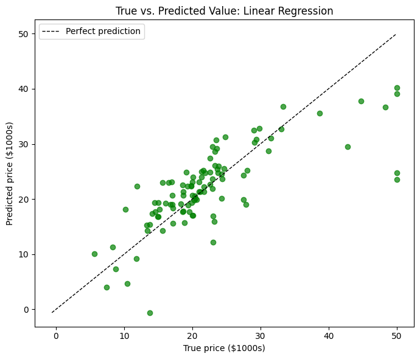
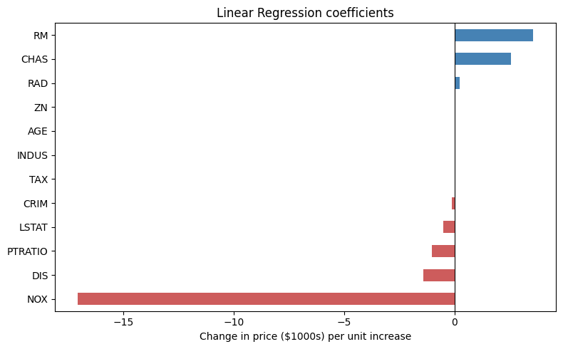

# Boston House Price Prediction with Linear Regression

Predicts the **median value of owner-occupied homes** in Boston-area towns (in $1000s) from 1970s census features such as crime rate, average number of rooms, pollution level, distance to employment centres and pupil–teacher ratio. It uses Linear Regression on the classic Boston Housing dataset.

## What it does

1. Downloads the Boston Housing dataset from [OpenML](https://www.openml.org/d/531) (506 towns, 13 features plus the target `MEDV`), or reads a local CSV if one is configured.
2. Converts every column to plain numbers. OpenML stores `CHAS` and `RAD` as categories.
3. Excludes the `B` feature by default (see the note below).
4. Splits the data into 80% training and 20% test.
5. Fits a Linear Regression model.
6. Reports **MSE**, **RMSE**, **MAE** and **R²** on the test set, next to a baseline that always predicts the average price.
7. Prints and plots the model's **coefficients**: how much the predicted price changes for a one-unit increase in each feature.
8. Plots true vs. predicted prices, with a perfect-prediction line, and the residuals.

### The features

| Feature | Meaning |
|---------|---------|
| `CRIM` | Per-capita crime rate by town |
| `ZN` | Share of residential land zoned for large lots (over 25,000 sq ft) |
| `INDUS` | Share of non-retail business acres per town |
| `CHAS` | 1 if the town borders the Charles River, else 0 |
| `NOX` | Nitric oxide concentration (parts per 10 million) |
| `RM` | Average number of rooms per dwelling |
| `AGE` | Share of owner-occupied units built before 1940 |
| `DIS` | Weighted distance to five Boston employment centres |
| `RAD` | Index of accessibility to radial highways |
| `TAX` | Property tax rate per $10,000 |
| `PTRATIO` | Pupil–teacher ratio by town |
| `LSTAT` | % of the population with lower socioeconomic status |
| `MEDV` | **Target**: median home value in $1000s |

## Concepts covered

- **Linear Regression** — the model predicts price as a weighted sum of the features plus an intercept, choosing the weights that minimize squared error on the training data. It is simple, fast, and every weight can be read directly.
- **Interpreting coefficients** — a coefficient of +7 on `RM` would mean "one extra room is associated with a $7,000 higher median value, holding the other features fixed". Coefficients are in each feature's own units, so their *size* can't be compared directly across features. Their *sign* still shows direction.
- **Regression metrics**
  - **MSE** — the average squared error. It penalizes big misses heavily.
  - **RMSE** — the square root of MSE, back in $1000s.
  - **MAE** — the average absolute miss in $1000s.
  - **R²** — the share of the variation in prices that the model explains: 1.0 is perfect and 0 is no better than guessing the average.
- **Baselines** — comparing MAE against "always predict the training average" shows how much the features actually help.
- **Residual plots** — if the model fits well, residuals scatter randomly around zero. A curve or funnel shape means the relationship isn't fully linear, or the errors grow with price.
- **Data types from external sources** — datasets loaded from repositories don't always arrive as plain numbers. OpenML marks `CHAS` and `RAD` as categories, so they are converted before modelling.

## Project structure

```
main.py      # full pipeline, organized into functions (config, loading,
              # type conversion, split, Linear Regression, metrics,
              # coefficients, plotting)
README.md    # this file
```

The code is organized into small, named functions driven by a `PipelineConfig` dataclass: `load_data`, `split_data`, `train_linear_regression`, `evaluate_model`, `coefficients`, `plot_true_vs_predicted`, `plot_residuals`, `plot_coefficients`. `run_pipeline()` runs them in order.

Settings such as the data source, excluded columns, test size and random seed live in `PipelineConfig`, so you can experiment without touching the pipeline code:

```python
from main import PipelineConfig, run_pipeline

run_pipeline(PipelineConfig(csv_path="boston.csv"))   # use a local copy instead of downloading
run_pipeline(PipelineConfig(drop_columns=[]))          # include every original feature
```

## Requirements

```
numpy
pandas
matplotlib
scikit-learn
```

Install with:

```bash
pip install numpy pandas matplotlib scikit-learn
```

## How to run

```bash
python main.py
```

The dataset is downloaded from OpenML the first time and cached afterwards, so the first run needs an internet connection.

## Sample output

Running the script prints the first rows of the data, the features used, the train/test shapes, the test-set metrics with the baseline, and the model coefficients, then displays three charts.

**True vs. predicted prices**



**Linear Regression coefficients**



**Test-set performance**

| Metric | Value |
|--------|------:|
| MSE | _run to fill in_ |
| RMSE | _run to fill in_ |
| MAE | _run to fill in_ |
| R² | _run to fill in_ |

## A note on the results and the dataset

On this dataset, Linear Regression typically explains a good share of the variation in prices but leaves clear room for improvement. Two patterns show up in the plots:

- **Rooms and socioeconomic status dominate.** `RM` (more rooms, higher price) and `LSTAT` (higher share of lower-status residents, lower price) are usually the strongest signals.
- **The price cap.** `MEDV` is capped at 50 ($50,000), so the most expensive towns all share the same recorded value. This shows up as a vertical line of points on the true-vs-predicted plot, where the model under-predicts.

Natural next steps would be adding interaction or squared terms (for example `RM²`), trying regularized models (Ridge, Lasso) or tree-based models (Random Forest, Gradient Boosting), and using cross-validation instead of a single split.

**About the dataset itself.** Boston Housing is a historical teaching dataset with known problems. The `B` feature was computed from the proportion of Black residents in each town, built into the data on the assumption that racial composition affects house prices. scikit-learn removed its built-in `load_boston` function in version 1.2 for this reason. This project leaves `B` out by default. Set `drop_columns=[]` to reproduce analyses that use all 13 features. For new work, the [California Housing dataset](https://scikit-learn.org/stable/datasets/real_world.html#california-housing-dataset) (`sklearn.datasets.fetch_california_housing`) is a common modern replacement.

## References

- [OpenML — Boston Housing dataset](https://www.openml.org/d/531)
- [scikit-learn — LinearRegression](https://scikit-learn.org/stable/modules/generated/sklearn.linear_model.LinearRegression.html)
- [scikit-learn 1.2 release notes — removal of `load_boston`](https://scikit-learn.org/stable/whats_new/v1.2.html)
- [GeeksforGeeks — Machine Learning Projects](https://www.geeksforgeeks.org/machine-learning/machine-learning-projects/), used as a general reference/inspiration while working on this project.

---
*This is a personal learning project for practising regression.*
