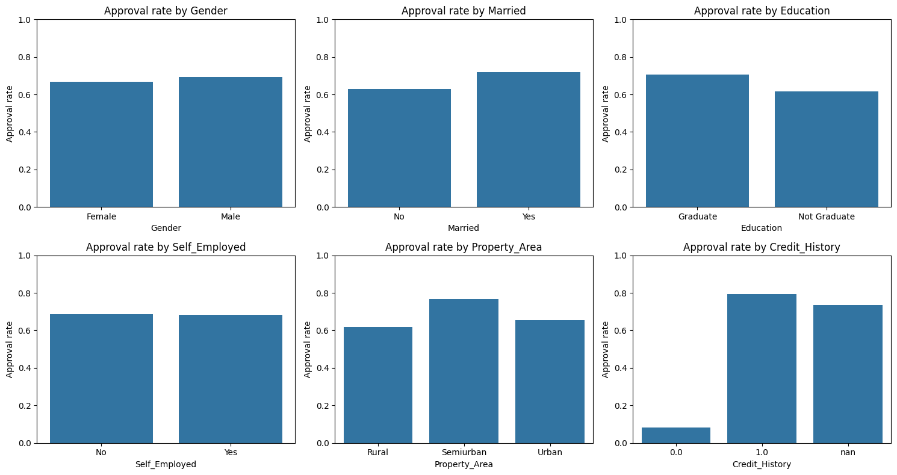
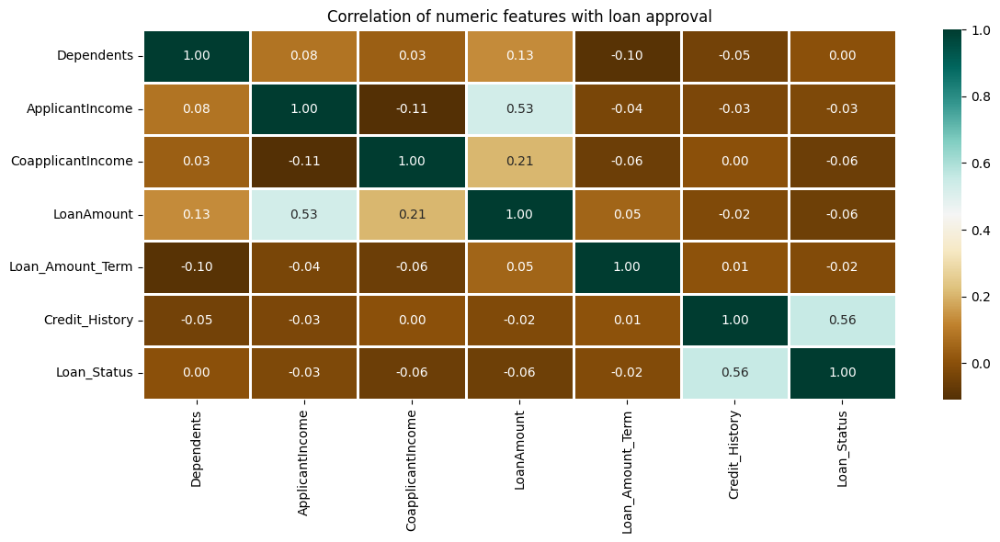

# Loan Approval Prediction

Predicts whether a **loan application will be approved** from the applicant's profile: gender, marital status, dependents, education, self-employment, applicant and co-applicant income, loan amount and term, credit history, and property area. It compares four classifiers: Random Forest, K-Nearest Neighbours, SVM and Logistic Regression.

## What it does

1. Loads the loan applications (`LoanApprovalPrediction.csv`, 598 applications), drops the `Loan_ID` column and reports the missing values in each column.
2. Prints the **approval rate**. That is also the accuracy of the simplest possible model, which approves everyone.
3. Plots:
   - counts for every categorical column;
   - the **approval rate** within each category (gender, marital status, education, self-employment, property area, credit history);
   - a correlation heatmap of the numeric features against approval.
4. Splits the data into 60% training and 40% test, stratified so both keep the same approval ratio.
5. Builds one **preprocessing pipeline**, fitted on the training data only:
   - categorical columns: fill missing values with the most common category, then encode as numbers;
   - numeric columns: fill missing values with the median;
   - all columns: standardize.
6. Trains Random Forest, K-Nearest Neighbours (k = 3), SVM and Logistic Regression inside that pipeline. Prints their training and test accuracy side by side, plus a classification report for the best model.

## Concepts covered

- **Imputing missing values the right way**
  - *Order:* fill gaps *before* encoding. If text columns are label-encoded first, a missing value becomes its own made-up category ("missing gender" = 2).
  - *Strategy per column type:* categorical columns get the most common value. Numeric columns get the median, which is less affected by very large incomes than the mean.
- **Preprocessing pipelines** — scikit-learn's `Pipeline` and `ColumnTransformer` bundle imputation, encoding, scaling and the model into one object. Calling `fit` on training data learns the fill values and scaling *only* from that data. That prevents the test set from leaking into training and keeps every model's preprocessing identical.
- **Feature scaling and distance-based models** — KNN and SVM compare applicants by distance. Without scaling, `ApplicantIncome` (thousands) completely drowns out `Credit_History` (0 or 1). Logistic Regression also trains faster and more reliably on scaled data. Random Forests don't need scaling but aren't harmed by it.
- **Comparing several models** — training a tree ensemble, a neighbour-based model, a margin-based model and a linear model on the same split shows which kind of decision boundary suits the data.
- **Train vs. test accuracy** — a model that scores far higher on training data than on test data (Random Forest here) is **overfitting**: it memorized the training applicants rather than learning rules that generalize.
- **The approval-rate baseline** — most applications in this dataset are approved. A model must clearly beat "approve everyone" to be useful, and rejected-class recall shows whether it actually spots risky applications.

## Project structure

```
main.py      # full pipeline, organized into functions (config, loading,
              # exploration plots, preprocessing pipeline, stratified split,
              # model comparison, classification report)
README.md    # this file
```

The code is organized into small, named functions driven by a `PipelineConfig` dataclass: `load_data`, `split_columns`, `approval_rate`, `build_preprocessor`, `get_models`, `split_data`, `train_and_compare`, `plot_category_counts`, `plot_approval_by_category`, `plot_correlations`. `run_pipeline()` runs them in order.

Settings such as the test size, whether to scale features, and the KNN and Random Forest hyperparameters live in `PipelineConfig`, so you can experiment without touching the pipeline code. For example, to see what happens without scaling:

```python
from main import PipelineConfig, run_pipeline

run_pipeline(PipelineConfig(scale_features=False))
```

## Requirements

```
pandas
matplotlib
seaborn
scikit-learn
```

Install with:

```bash
pip install pandas matplotlib seaborn scikit-learn
```

## How to run

Place `LoanApprovalPrediction.csv` in the same directory as `main.py`, then:

```bash
python main.py
```

## Sample output

Running the script prints the missing-value counts, the approval rate, the feature types, a model comparison table and a classification report for the best model, then displays the charts.

**Approval rate by category**



**Correlation heatmap**



**Results from the original notebook (before the preprocessing fixes)**

| Model | Train accuracy | Test accuracy |
|-------|---------------:|--------------:|
| Random Forest | 98.04% | **82.50%** |
| Logistic Regression | 79.61% | 80.83% |
| SVM | 68.72% | 69.17% |
| K-Nearest Neighbours | 78.49% | 63.75% |

## A note on the results

These numbers come from the original notebook, which had no feature scaling. They show the problems the new pipeline fixes:

- **SVM** scored about 69% on both training and test data. That is roughly the share of approved loans, so it was most likely predicting "approved" for everyone. Unscaled income figures dominated its distance calculations.
- **KNN** fell from 78% on training data to 64% on test data, for the same reason: neighbours were chosen almost entirely by income.
- **Random Forest** hit 98% on training data but 82.5% on test data. Seven trees with no depth limit memorize the training applicants, which is a clear sign of **overfitting**.
- **Logistic Regression** stopped before fully converging (scikit-learn warned about this) but still did well. That's a hint that a simple linear rule captures most of the signal.

With scaling and proper imputation, expect SVM and KNN to improve noticeably. Rerun the script and update the table above with your new numbers.

**Credit history** is usually the single strongest factor in this dataset: applicants with a good credit history are approved far more often, which the "approval rate by category" chart makes easy to see.

Natural next steps:

- cross-validation instead of a single split;
- tuning the Random Forest (more trees, a depth limit);
- adding features such as total income or loan amount relative to income;
- looking closely at the rejected-class recall, since missing risky applicants is usually the costliest mistake for a lender.

## References

- [scikit-learn — Pipelines and composite estimators](https://scikit-learn.org/stable/modules/compose.html)
- [scikit-learn — Imputation of missing values](https://scikit-learn.org/stable/modules/impute.html)
- [GeeksforGeeks — Machine Learning Projects](https://www.geeksforgeeks.org/machine-learning/machine-learning-projects/), used as a general reference/inspiration while working on this project.

---
*This is a personal learning project. Predictions from this model should not be used for real lending decisions.*
