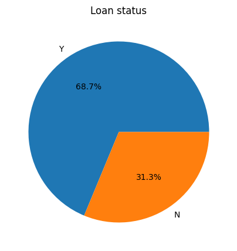
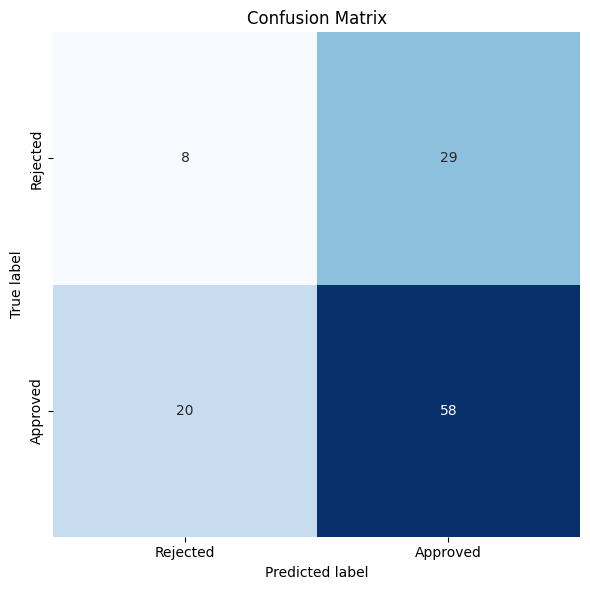

# Loan Eligibility Prediction with an SVM

Predicts whether a **loan application will be approved** from four applicant details: gender, marital status, applicant income and loan amount. It uses a Support Vector Machine (SVM) with an RBF kernel, trained on a class-balanced training set.

## What it does

1. Loads the loan data (`loan_data.csv`, 598 applications with `Loan_ID`, `Gender`, `Married`, `ApplicantIncome`, `LoanAmount`, `Loan_Status`) and reports missing values.
2. Plots:
   - the share of approved vs. rejected loans (pie chart);
   - approvals by gender and by marital status;
   - the distributions and box plots of applicant income and loan amount.
3. Drops rows with a missing loan amount and removes **income outliers** (applicants earning 25,000 or more).
4. Prints the mean loan amount by gender, and by marital status and gender.
5. Label-encodes gender and marital status, and turns `Loan_Status` into 1 (approved) / 0 (rejected). `Loan_ID` is left out of the features.
6. Splits the data into 80% training and 20% validation.
7. **Oversamples** the minority class (rejected loans) in the training set only, so both classes are the same size.
8. Standardizes the features (scaler fitted on training data only).
9. Trains an RBF-kernel SVM. Reports accuracy and **ROC AUC** on both sets, a majority-class baseline, and a classification report.
10. Plots a confusion matrix.

## Concepts covered

- **Identifiers are not features** — `Loan_ID` is just a reference code. Label-encoding it and feeding it to the model gives the SVM a meaningless number to fit, which adds noise and can only hurt.
- **Outlier removal** — a few very high incomes stretch the scale and would dominate the SVM's distance calculations. Capping income at 25,000 keeps the model focused on typical applicants.
- **Handling missing values explicitly** — rows with no loan amount are dropped on purpose and the count is printed, rather than disappearing silently inside a comparison filter.
- **Class imbalance and oversampling** — about two-thirds of applications are approved. Left alone, a model can score well by approving almost everyone. `RandomOverSampler` duplicates random rejected applications until both classes are equal.
- **Why oversampling comes after the split** — oversampling before splitting would put copies of the same application in both the training and validation sets, making the validation score look better than it really is.
- **Feature scaling for SVMs** — the RBF kernel measures similarity by distance. Without scaling, income (thousands) would completely swamp gender and marital status (0 or 1).
- **RBF-kernel SVM** — finds the boundary between approved and rejected applicants with the widest possible margin, and the RBF kernel lets that boundary curve rather than being a straight line.
- **Accuracy vs. ROC AUC** — accuracy counts correct yes/no predictions. ROC AUC measures how well the model *ranks* applicants: 0.5 is random guessing and 1.0 is perfect. It must be computed from the model's continuous scores (`decision_function`), not from hard 0/1 predictions.

## Project structure

```
main.py      # full pipeline, organized into functions (config, loading,
              # exploration plots, outlier/missing removal, encoding, split,
              # oversampling, scaling, SVM training, evaluation)
README.md    # this file
```

The code is organized into small, named functions driven by a `PipelineConfig` dataclass: `load_data`, `remove_outliers_and_missing`, `encode_features`, `split_data`, `balance_training_set`, `scale_features`, `train_svm`, `evaluate_model`, plus the plotting functions. `run_pipeline()` runs them in order.

Settings such as the income cap, whether to oversample, the SVM kernel and the random seeds live in `PipelineConfig`, so you can experiment without touching the pipeline code. For example, to see the effect of oversampling:

```python
from main import PipelineConfig, run_pipeline

run_pipeline(PipelineConfig(oversample=False))
```

## Requirements

```
pandas
matplotlib
seaborn
scikit-learn
imbalanced-learn
```

Install with:

```bash
pip install pandas matplotlib seaborn scikit-learn imbalanced-learn
```

## How to run

Place `loan_data.csv` in the same directory as `main.py`, then:

```bash
python main.py
```

## Sample output

Running the script prints the missing-value counts, the rows removed, the oversampled class counts, a table of accuracy and ROC AUC for training and validation, the majority-class baseline and a classification report, then displays the charts.

**Loan status**



**Confusion matrix**



**Results from the original notebook (before the fixes)**

| Set | ROC AUC (from 0/1 predictions) | Accuracy |
|-----|-------------------------------:|---------:|
| Training | 0.630 | – |
| Validation | 0.482 | 0.55 |

Validation recall was 0.30 for rejected loans and 0.67 for approved loans.

## A note on the results

The original notebook's validation ROC AUC of 0.48 is slightly *worse than random guessing*, and its 55% accuracy is below what you would get by simply approving everyone (about 68%). A few things contributed:

- `Loan_ID` was label-encoded and used as one of the five features, adding pure noise;
- the "accuracy" printed was actually ROC AUC calculated from hard 0/1 predictions, which throws away the model's ranking information;
- the loan-amount filter (`< 400000`) never removed anything, because loan amounts are recorded in thousands. Its only effect was silently dropping rows with a missing amount.

All three are fixed here. The bigger limitation is the data itself: gender, marital status, income and loan amount carry very little information about approval. In fuller versions of this dataset, **credit history** is by far the strongest predictor, and it isn't included in this file. So even after the fixes, expect the model to land near the baseline. Rerun the script and update the table above with your new numbers.

Natural next steps:

- add credit history, education and property area if a fuller version of the data is available;
- tune the SVM's `C` and `gamma` with cross-validation;
- compare against Logistic Regression and Random Forest.

## References

- [scikit-learn — SVC](https://scikit-learn.org/stable/modules/generated/sklearn.svm.SVC.html)
- [imbalanced-learn — RandomOverSampler](https://imbalanced-learn.org/stable/references/generated/imblearn.over_sampling.RandomOverSampler.html)
- [scikit-learn — ROC AUC](https://scikit-learn.org/stable/modules/generated/sklearn.metrics.roc_auc_score.html)
- [GeeksforGeeks — Machine Learning Projects](https://www.geeksforgeeks.org/machine-learning/machine-learning-projects/), used as a general reference/inspiration while working on this project.

---
*This is a personal learning project. Predictions from this model should not be used for real lending decisions.*
